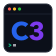

this project has moved to https://github.com/c3lang/c3-playground - https://play.c3-lang.org/

---

<a href="https://c3-lang.org">
  
</a>

<h1>C3 Playground<br><br><br></h1>

<div align="center">
  Code editor and compiler for C3 in the browser.
  <a href="https://manulinares.github.io/c3-playground/">
    <strong>( Start Coding )</strong>
  </a>
</div>

<br><br>

<div align="center">
  <a href="https://manulinares.github.io/c3-playground/">
    
  </a>
</div>

## Running Locally

You can download pre-built playground artifacts from CI or Releases and run them offline with any local static HTTP server:

1. Download `c3-playground.zip` from the latest [GitHub Releases](https://github.com/ManuLinares/c3-playground/releases) or the **Artifacts** section of the latest [Actions CI run](https://github.com/ManuLinares/c3-playground/actions).
2. Extract the archive into a folder.
3. Start a local HTTP server in that directory:
   ```bash
   # Python 3
   python3 -m http.server 8000

   # or Node.js
   npx serve .
   ```
4. Open `http://localhost:8000` in your web browser.

